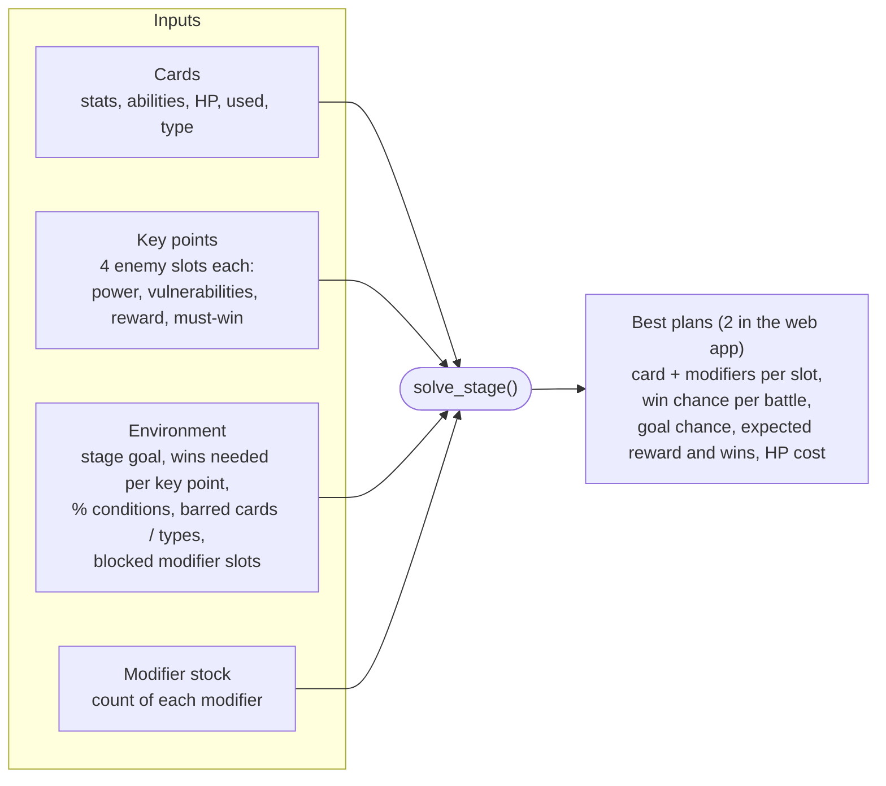
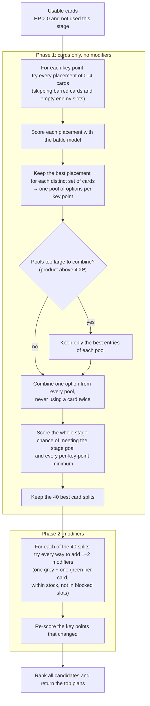
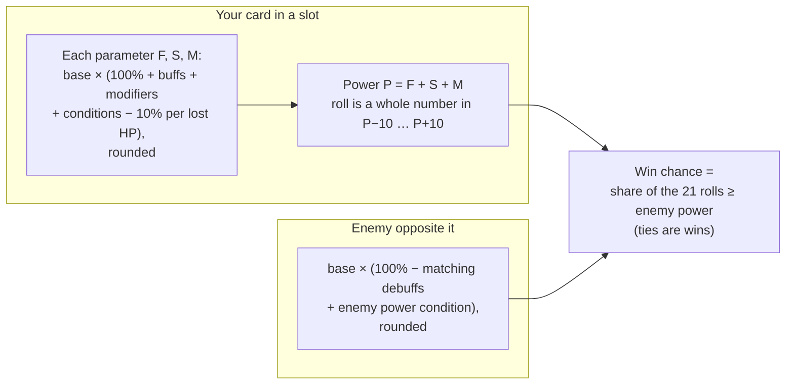

# How the solver works

The solver lives in [`webapp/engine/solver.py`](../webapp/engine/solver.py). It has no web
dependencies: the web app and the command-line tool both call `solve_stage()` with the same
inputs.

Given your cards, the key points of a stage and your modifier stock, it suggests which cards
to place where, and with which modifiers, so that the stage goal is met as reliably as
possible.

## Inputs and output

## The search

### How plans are ranked

Plans are compared on these, in order. A later item only breaks ties in the earlier ones.

1. **Chance of meeting the stage goal**, including every per-key-point minimum and every
   must-win enemy.
2. **Expected reward**, minus the point value of the modifiers the plan spends.
3. **Expected number of wins.**
4. **Lowest HP cost**: the card power lost to the 1 HP each placed card spends.

## The battle model

Each placement is scored with the game's numbers, checked against in-game observations
(`validate()` reproduces them on every command-line run and in the tests).

- **Buffs** go to the neighbour on the left or right; **debuffs** hit the enemy diagonally
  left, straight ahead or diagonally right, and only if it has that vulnerability (or the card
  carries Rabid).
- **Buff power / Debuff power** conditions and Teamwork / Specialization scale each ability:
  a 20% debuff at −50% debuff power gives 10%, or 30% with Specialization.
- Win chances of the battles in a key point are combined into a distribution of wins, so the
  chance of "at least N wins" is exact rather than estimated. A Morale win counts twice.

## Why it can take minutes

The search is exhaustive, so its size grows quickly with the number of usable cards and key
points:

| Usable cards | Placements tried per key point (4 enemies) |
|---|---|
| 12 | 18,001 |
| 16 | 58,625 |
| 20 | 146,001 |
| 24 | 307,009 |

Combining several key points multiplies the options again; for example, 3 key points with 24
cards compare a few million card splits. Typical times on a desktop:

| Stage | Time |
|---|---|
| 1 key point | a few seconds |
| 2 key points, about 20 cards | under a minute |
| 3 key points, 20–24 cards | 2–5 minutes |

Fewer usable cards (barred, already used, or at 0 HP) make it faster. Solving one key point at
a time, while the stage is still marked incomplete, is also faster than solving all key points
together, but only the joint solve can trade cards between key points.

## Assumptions not yet confirmed in game

These are marked `ASSUMPTION` in the code:

- **Focused:** the card neither gives nor receives buffs, and its debuffs are off.
- **Unstoppable:** ignores the battle conditions on its own parameters and on the power of its
  own buffs and debuffs. It does not lift card bans, modifier bans or HP loss.
- **Buff / debuff power** conditions add to Teamwork / Specialization (×1.5 under −50%), rather
  than multiplying them.
- **Enemy power** conditions add to the same pool as debuffs.
- **Fast Repair:** +2 HP (up to 3) before the battle, which then costs 1 HP as usual.
