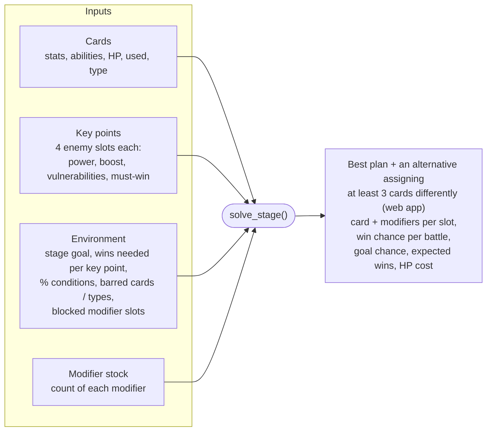
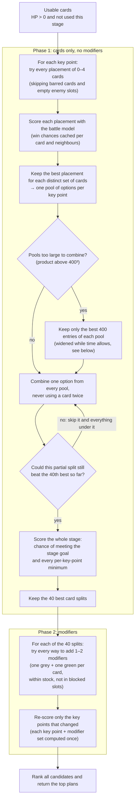
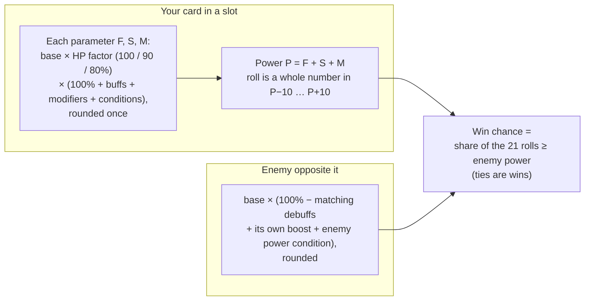

# How the solver works

The solver lives in [`webapp/engine`](../webapp/engine) and has no web dependencies:

| Module | What it does |
|---|---|
| [`model.py`](../webapp/engine/model.py) | The battle model: scores one placement of cards at a key point |
| [`search.py`](../webapp/engine/search.py) | The stage search, `solve_stage()` |
| [`solver.py`](../webapp/engine/solver.py) | CSV readers and `validate()`; re-exports the other two |

The web app calls `solve_stage()` with the stage you entered.

Given your cards, the key points of a stage and your modifier stock, it suggests which cards
to place where, and with which modifiers, so that the stage goal is met as reliably as
possible.

## Inputs and output

## The search

### How plans are ranked

Plans are compared on these, in order. A later item only breaks ties in the earlier ones.

1. **Chance of meeting the stage goal**, including every per-key-point minimum and every
   must-win enemy.
2. **Expected number of wins.**
3. **Fewest modifier points spent**, so a modifier is only used when it raises the goal
   chance or the expected wins.
4. **Lowest HP cost**: the card power lost to the 1 HP each placed card spends.

Enemy rewards are not ranked: to make sure an enemy with a reward you want is beaten, mark
it must-win.

### The alternative plan

The second-best plan overall is nearly always the best plan with a trivial change: two cards
swapped within a key point, or one card replaced by an equal one. So the web app's plan 2 is
instead **the best plan that assigns at least 3 cards differently** from plan 1. A card counts
once whether it joins, leaves, or moves to another key point; replacing one card with another
counts as 2. Card positions within a key point and modifiers don't count.

Plan 1 is found as usual. Plan 2 comes from a second search over the same options that skips
every split within 3 changes of plan 1, followed by its own modifier search, so it is the
true best plan under that rule rather than the best of a few near-copies. The page shows how
many cards differ. The threshold is `distinct=3` in the web app's `SOLVE_LIMITS`
([`webapp/sandbox.py`](../webapp/sandbox.py)); the second search costs about one more search
round.

## The battle model

Each placement is scored with the game's numbers, checked against in-game observations
(`validate()` and the tests reproduce them).

- **HP** scales the whole parameter, buffs included: at 2 HP a card with a +30% buff gets
  90% × 130%, not 120% (confirmed in game).
- **Buffs** go to the neighbour on the left or right; **debuffs** hit the enemy diagonally
  left, straight ahead or diagonally right, and only if it has that vulnerability (or the card
  carries Rabid).
- **Buff power / Debuff power** conditions and Teamwork / Specialization scale each ability:
  a 20% debuff at −50% debuff power gives 10%, or 30% with Specialization.
- Win chances of the battles in a key point are combined into a distribution of wins, so the
  chance of "at least N wins" is exact rather than estimated. A Morale win counts twice.

## How long a solve takes

The search space grows quickly with the number of usable cards:

| Usable cards | Placements per key point (4 enemies) |
|---|---|
| 12 | 18,001 |
| 16 | 58,625 |
| 20 | 146,001 |
| 24 | 307,009 |

Combining key points multiplies that again: 3 key points with 24 cards have billions of
possible card splits. These keep the solve to seconds, without changing which plans it finds:

1. **Cheap placement scoring.** A card's win chance in a slot depends only on the card and
   what its two neighbours do to that slot, so each chance is computed once and reused, and
   placements are ranked with whole numbers (a chance is always n out of 21). The full
   battle model only runs for the placements that are kept.
2. **Branch and bound.** Once 40 splits are held, a partial split is dropped when even its
   best possible completion cannot beat the weakest of them. "Best possible" combines, for
   the key points still to choose, the highest chance of each win count, the most expected
   wins, and the lowest modifier spend and HP cost that any of their options offers. That is
   an upper bound, so nothing that would have made the top 40 is dropped.
3. **Ties are bounded tightly.** Many plans tie on goal chance and wins (for example when
   every battle is a certain win) and differ only in HP cost. A split can only tie on wins by
   taking a most-wins option at every remaining key point, so for ties the cost bound uses
   the cheapest *most-wins* option, not the cheapest option overall (which would be the
   empty one).
4. **Stopping a scan early.** Each key point's options are sorted best first. Every 32
   options the search checks the best that any of the remaining ones could still achieve,
   and stops scanning that list once none of them could beat the weakest split held.
5. **Modifiers only where they can help.** A modifier costs points, and spend ranks before
   HP cost, so it can only improve a plan by raising the goal chance or the expected wins.
   When a plan's goal is already certain, modifiers are only tried at key points with a
   battle that is not yet certain. This applies when a search only needs its single best
   plan, as in the web app; a modifier whose value is set to 0 turns it off.
6. **Reused modifier results.** A key point's result with a given set of modifiers is
   computed once and shared by every split and variant that contains it.

[`tests/test_search.py`](../tests/test_search.py) checks that the results match the plain
exhaustive search on generated stages, including close contests won with modifiers.

### Trimming the options, and the time budget

If combining every option would mean more than 400³ splits, each key point's options are
first cut to the ones it ranks highest on its own (400 each with 3 key points, 8,000 each
with 2). That can hide the best plan: a split that is best for the whole stage may use an
option that looks weak for its own key point, for example one that leaves strong cards free
for a harder key point. On 30 generated 3-key-point stages this happened once (measured with
an earlier ranking), with a slightly worse plan than the true best.

So the web app uses a **time budget of about 20 seconds**: after the first, trimmed round,
the search is repeated with twice as many options each time (up to all of them) while the
next round is expected to finish within half the budget, leaving the rest for modifiers and
the alternative plan. Each round includes everything the previous one searched, so it can
only find better plans; a round that runs over is abandoned for the last complete one. The
first round always completes, so a very hard stage can take somewhat longer than the budget.

With the bounds above, most stages reach every option well within the budget. The map page
shows how far the search got: *searched every option*, or *best N options per key point (time
limit)*. Tests and scripts that call `solve_stage()` without a budget keep the fixed trim, so
their results never depend on the machine.

### Times

On a desktop, with the web app's settings (plan 1 and an alternative):

| Stage | Time | Options searched |
|---|---|---|
| Map 10, stage 1: 29 cards, 2 key points | 4 s | all (104 s and 8,000 per key point before the tie bound) |
| The example in `tests/data`: 24 cards, 3 key points | 3 s | all |
| A hard generated close contest: 24 cards, 3 key points | 6 s | all (13 s at 400 per key point before) |

The very first version of the search took about 200 s on the example at 400 options. Fewer
usable cards (barred, already used, or at 0 HP) make every solve faster.

## Assumptions not yet confirmed in game

These are marked `ASSUMPTION` in the code:

- **Focused:** the card neither gives nor receives buffs, and its debuffs are off.
- **Unstoppable:** ignores the battle conditions on its own parameters and on the power of its
  own buffs and debuffs. It does not lift card bans, modifier bans or HP loss.
- **Buff / debuff power** conditions add to Teamwork / Specialization (×1.5 under −50%), rather
  than multiplying them.
- **Enemy power** conditions add to the same pool as debuffs, like an enemy's own boost does
  (that part is confirmed in game: base 108, +16% and a 20% debuff gave 104).
- **Fast Repair:** +2 HP (up to 3) before the battle, which then costs 1 HP as usual.
